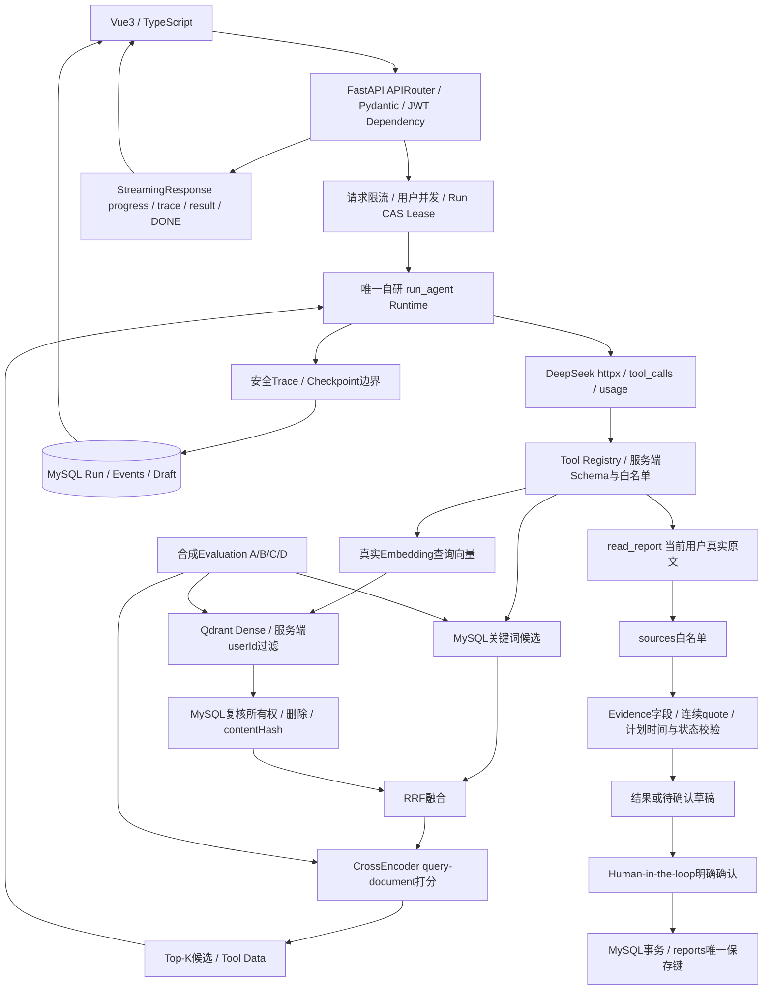

# Python 最终架构与数据边界

本文件描述 backend/app 中的 Python 实现。迁移验收与切换状态见 PYTHON_MIGRATION.md；真实检索/模型指标见 AGENT_EVALUATION.md。Node 行为只作为迁移对照，不是新增第二套 Agent 框架。



## 完整请求数据流

1. Vue发送question或本周工作，携带Bearer Token和requestKey；不提交可信userId。
2. Pydantic与业务校验检查类型/长度，JWT Dependency从签名token得到用户身份。
3. 服务端检查当前进程的用户并发与限流；RunStore使用UNIQUE(user_id,request_key)、原始规范化输入比对、CAS leaseToken抢占。
4. 任务配置只提供system、用户输入、工具集合、上下文、最终validator；三类任务共用run_agent。
5. DeepSeek返回完整assistant消息，Runtime检查finishReason、tool_calls、调用ID、轮次和用量。
6. Registry拒绝未知工具、userId等额外参数、错误类型和越界数量。数据库身份只能从ctx.userId来。
7. 按需混合召回：MySQL关键词→Embedding→Qdrant服务过滤userId/modelVersion→MySQL复核当前正文hash→RRF→CrossEncoder→候选。
8. 候选仅放入role:tool，不写sources，也不改变system。模型决定是否read_report；原文读取再次按reportId+userId校验。
9. 模型输出JSON，由Evidence Validator核对实际来源、字段、连续原文、跨记录约束及计划后续证据。
10. 每个边界先持久化安全Trace与Checkpoint；验证结果先保存，再通过SSE发送result和[DONE]。Trace不是成功信号。
11. 追问结果建立持久化sessionId；生成完整流和事实校验后得到ready草稿。confirm=true且正文一致才进行正式INSERT。
12. 中断任务从保存输入重跑、重新读原文；不恢复旧sources或半完成工具消息。成功重复请求只重放结果。

## 数据归属

- MySQL users/reports：密码哈希、已确认正式周报、原始工作/问题/计划；原有唯一键和索引不改写。
- MySQL agent_runs：runId、用户、requestKey、task、规范化input、attempt、leaseToken、leaseUntil、终态、checkpoint和已校验result。
- MySQL agent_run_events：有序安全执行事件，不保存原始query、正文、reasoning_content、请求头或密钥。
- MySQL agent_drafts：七天待确认草稿、原始输入、问题、补充事实、ready/saved状态、generationToken；不是正式周报。
- Qdrant：真实dense向量及userId/reportId/contentHash/modelVersion元数据。正文与Evidence权威仍在MySQL。
- backend/.cache：下载的模型与Qdrant二进制，不进Git；backend/.qdrant是本地数据库存储。生产也可配置远程Qdrant服务。
- eval/results：合成测试实际运行JSON/Markdown，包含样本与指标，不存真实用户数据。

## Qdrant结构

collection名称由Embedding模型ID与固定revision的指纹形成，向量维度在建立/加载时校验，distance=COSINE。pointId是UUID5(collection,userId,reportId)，相同记录更新覆盖同一点。

```json
{
  "id": "服务端生成的UUID5",
  "vector": [0.12, -0.04],
  "payload": {
    "userId": 7,
    "reportId": 1,
    "contentHash": "正文前6000字的SHA256",
    "modelVersion": "Embedding配置的模型指纹"
  }
}
```

示例vector仅说明结构，不作为评估向量。实际维度以真实模型输出与collection配置为准。检索must过滤userId与modelVersion；返回point再由MySQL复核是否存在、是否属于该用户、正文hash是否仍匹配。更新/删除接口尽力失效Qdrant；即使失效请求失败，SQL复核仍阻止旧正文/删除记录被采用。

## Reranker与降级

CrossEncoder对融合后的最多20个query-document对联合编码，按相关性分数重排，再取Top-K。它不能预先给文档生成独立向量，因此放在候选融合之后以控制CPU成本。库使用sentence-transformers，trust_remote_code=False；必须真实加载与运行后才能声明已验收。

Embedding失败→关键词；Qdrant失败→关键词；重排序失败→RRF或关键词。fallbackReasons、各通道数量、选中ID、Embedding/Vector/Rerank/总耗时与预算进入Trace。取消直接传播，不伪装为成功降级。

## Runtime、Trace与恢复

Runtime保留8轮、12次工具、每轮6次工具、每轮3000输出Token、累计80000Token、50000字符上下文、最多两次修订和180秒运行上限。Embedding和重排的tokenizer输入用量也计入检索预算；本地模型Token是计算量计数，不是DeepSeek账单。

Trace记录type/stage/runId/attempt/seq/timestamp/elapsedMs/meta。meta只投影工具名、callId、文本长度、参数数值、结果数量/ID、检索模式、fallback、用量、预算、校验码及耗时。私有推理只留在本次内存消息用于协议，Checkpoint不保存它。

Checkpoint只含boundary、stats、sourceIds、recovery=restart_from_input；恢复时仍重新读当前原文。四分钟租约和CAS阻止旧尝试覆盖新Run，最多三次attempt。成功requestKey重放不再调用模型，输入冲突返回409。

确认事务把幂等reports INSERT、正文核对和draft saved更新放在同一MySQL事务。确认操作通过shield保留明确授权写入，浏览器断线不假装回滚；重复确认返回同一reportId。

协议参考：[Qdrant过滤](https://qdrant.tech/documentation/search/filtering/)、[Sentence Transformers CrossEncoder](https://sbert.net/docs/package_reference/cross_encoder/model.html)、[FastAPI异步](https://fastapi.tiangolo.com/async/)。
