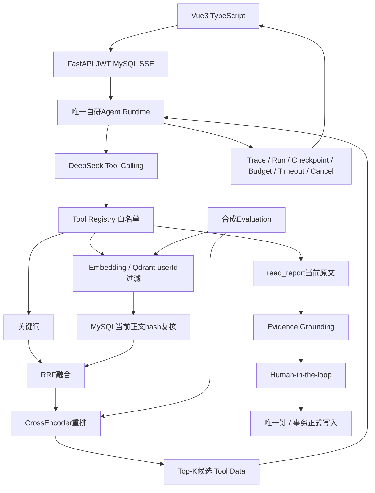

# AI Agent 智能工作复盘平台 — Python 最终版

**当前唯一主后端是 Python + FastAPI。** Vue3 + TypeScript 前端保持原有接口。原Node/Express保存在migration_reference/node，只用于迁移对照，不进入启动、Docker或CI后端路径。

本次完成后功能与技术框架冻结：后续只修Bug、性能优化、测试完善和学习。

## 已实现

- 前端按周报生成、工作趋势、计划跟踪、历史周报、执行记录分区导航（URL hash可直接打开、前进/后退）；页面切换保留输入与任务状态，恢复结果自动跳转到对应分区。
- 注册/登录、兼容既有bcrypt哈希、HS256 JWT、用户隔离的历史周报CRUD。
- 0到3个智能追问，同一session补充/跳过，完整流生成、事实检查和保守回退。
- 七天持久化草稿；生成不写正式reports，用户明确确认才幂等保存。
- 专业化/精简/OKR重写，预览后手动保存；复制/PDF及Markdown净化保留。
- 唯一自研Agent Runtime，DeepSeek Tool Calling、Registry白名单与严格参数校验。
- 趋势复盘、计划跟踪、原文Evidence校验；无充分证据返回空项/待确认。
- 真正Hybrid RAG：MySQL关键词 + 真实Embedding + Qdrant Dense服务 + RRF + sentence-transformers CrossEncoder + Top-K候选。
- 候选不是Evidence，必须read_report；Qdrant过滤userId/modelVersion，SQL再复核所有权、删除和正文hash。
- 安全Trace、持久化Run/Checkpoint、CAS Lease、最多三次安全重跑、成功请求重放。
- 模型/检索预算、Timeout、Cancel、并发限制、SSE progress/trace/result/DONE。
- 四路真实检索Evaluation、六例真实DeepSeek评估、JSON/Markdown报告、Node golden契约对照与安全/集成测试。

## 目录

```text
client/                         Vue3 / TypeScript，Node仅用于前端开发构建
backend/
  app/
    main.py                     FastAPI APIRouter / JWT Dependency / 业务入口
    models.py config.py         严格请求类型与服务端配置
    db.py stores.py             Async MySQL / Run / Draft / 确认事务
    runtime.py tools.py         唯一Runtime / Registry / 数据工具
    tasks.py prompts.py         三个任务配置
    evidence.py weekly.py       引用/状态/追问/草稿事实校验
    provider.py lifecycle.py    DeepSeek / StreamingResponse / Trace / Cancel
    retrieval.py http_guard.py  Qdrant / Embedding / RRF / CrossEncoder / 请求边界
  sql/                          原业务DDL与附加工程表
  scripts/                      迁移、预热、索引、真实验收、合成预览
  tests/                        单元、安全、契约、可靠性与Node对照
  eval/                         固定合成数据、指标、单命令评估、结果文件
migration_reference/node/       冻结的Node参考代码，非运行路径
AGENT_PROJECT_LEARNING.md        最终Python学习顺序与关键文件
AGENT_PROJECT_ARCHITECTURE.md    架构图、完整数据流、数据与权限边界
AGENT_EVALUATION.md              真实结果、指标定义与局限
PYTHON_MIGRATION.md              迁移对照、切换和回退
AGENT_PROJECT_INTERVIEW.md       30道真实代码面试题
AGENT_ACCEPTANCE.md              最终验收记录
```

## 架构与数据流



requestKey→JWT绑定用户→输入校验与并发→MySQL Run CAS→Runtime→模型自主选Tool→混合候选→read_report→sources白名单→Evidence Validation→持久化结果→SSE result+[DONE]。追问得到sessionId，完整草稿存ready，confirm=true与正文一致才写正式reports。

不保存或展示reasoning_content、原始query/正文到Trace。Checkpoint只记录安全边界与用量，恢复从保存输入重跑，重新读取当前原文；不是模型消息逐条续跑。

## 技术栈

Python 3.13、FastAPI、Pydantic、asyncio、httpx、SQLAlchemy Async + aiomysql、PyJWT、bcrypt；MySQL 8；Qdrant服务；sentence-transformers SentenceTransformer/CrossEncoder；DeepSeek原生Tool Calling。没有LangChain、LangGraph、Multi-Agent、MCP、Redis、Kafka、微服务或复杂工作流引擎。

本机实际依赖快照在backend/requirements.lock.txt；常规安装使用requirements.txt，CI无模型测试使用requirements-core.txt。MySQL保留原users/reports与确认唯一键；旧report_embeddings表可保留旧数据，但新Dense路径不读取MySQL JSON向量。

## 本地启动

配置在backend/.env，参考.env.example。当前迁移已保留原数据库/JWT/DeepSeek配置，不把真实文件入Git。核心变量：DB_HOST/PORT/USER/PASSWORD/NAME、JWT_SECRET、DEEPSEEK_API_KEY、DEEPSEEK_AGENT_MODEL/REPORT_MODEL、QDRANT_URL/API_KEY、LOCAL_EMBEDDING_MODEL/REVISION、RERANKER_MODEL。可设置已校验本地模型目录LOCAL_EMBEDDING_PATH/LOCAL_RERANKER_PATH，路径相对backend解析。

新环境在根目录：

```powershell
python -m venv backend/.venv
backend/.venv/Scripts/python.exe -m pip install -r backend/requirements.txt
# 仅当.env不存在时复制示例，再填写你自己的配置
cd backend
.venv/Scripts/python.exe -m scripts.migrate
```

新库先执行backend/sql/schema.sql，已有库只做附加迁移，不删表、不清空数据。迁移校验原确认键、Run唯一键和JSON字段；不兼容时停止。

先启动真实Qdrant。Windows本机已校验二进制存.cache/qdrant/bin，另一个终端执行：

```powershell
cd backend
./start_qdrant.ps1
```

也可使用官方Docker Qdrant或已有远程服务，配置QDRANT_URL；本机配置仅监听127.0.0.1，关闭Telemetry。模型首次下载需可访问模型仓库，先预热确认能加载和预测：

```powershell
cd backend
$env:PYTHONUTF8='1'
.venv/Scripts/python.exe -m scripts.warm_models
./start.ps1
```

第三个终端：

```powershell
cd client
npm ci
npm run dev -- --host 127.0.0.1
```

打开 http://127.0.0.1:5173，/api代理到FastAPI 3001，健康检查返回backend=fastapi。后端重启保留MySQL草稿与Run；异常running四分钟租约到期可显式重跑。

已有本机模型权重已真实加载与预测，缓存不进Git。Embedding为intfloat/multilingual-e5-small、384维，固定revision；CrossEncoder为cross-encoder/mmarco-mMiniLMv2-L12-H384-v1。新部署若网络受限需自行准备相同已校验模型目录，不能把下载失败说成Reranker已启用。

生产配置可参考docker-compose.yml：Python后端、MySQL、Qdrant、Nginx静态Vue。Docker文件已切换，但本机没有Docker，未声称完成Docker镜像/线上部署验收。

## 测试与评估

```powershell
cd backend
.venv/Scripts/python.exe -m pytest -q
.venv/Scripts/python.exe -m scripts.verify_mysql
.venv/Scripts/python.exe -m scripts.verify_parallel
.venv/Scripts/python.exe -m scripts.verify_live
.venv/Scripts/python.exe -m eval.run --live-agent
cd ../client
npm test
npm run typecheck
npm run build
```

verify_mysql只用MySQL临时表；verify_live真实调用DeepSeek/Qdrant/Embedding/CrossEncoder，Evaluation用独立合成集合，均不污染真实用户。真实DeepSeek调用产生少量费用。无密钥CI只跑Python与Client测试/构建，不自动调用收费模型。

预索引当前用户最近200份：`.venv/Scripts/python.exe -m scripts.index_reports --user 你的用户ID`，只写Qdrant基础设施数据，不改正式周报。合成界面预览：`.venv/Scripts/python.exe -m scripts.preview`，4175端口、engineering-demo/demo-password，只访问临时合成数据。

## 已验收与真实结果

Python 41项测试、Client 7项协议测试、TypeScript/生产构建、Node契约对照、真实MySQL确认幂等/Lease/HTTP、真实Qdrant和模型链路已通过。Vue验证了真实检索轨迹、刷新恢复、明确确认和取消中断。

固定12个检索问题中10个有正例，宏平均Recall@5：Keyword 0.725、Dense 0.950、RRF 0.950、Rerank 0.850。最终这次六例真实Agent均通过工具选择/来源/任务判据；Unsupported Claim Rate因缺逐句人工标签为N/A。**当前重排序在这组样本中未优于Dense/RRF，不宣传虚构提升比例。** 完整结果见AGENT_EVALUATION.md与backend/eval/results/latest.json。

## 仍有的限制

- 关键词最多50候选；在线补索引最多12份近期记录，预索引最多最近200份；Dense只覆盖已索引且当前hash有效的记录，不承诺全历史。
- 用户并发与限流是进程内；Run CAS保护同一requestKey，但不等于跨实例用户配额。
- 重跑有新预算、沿用runId并增加attempt，最多三次；不承诺文本完全相同。
- 没有周报周期/版本字段、正式计划状态表或自动提醒。创建时间不是工作周期。
- Evidence证明来源，不保证全部语义蕴含；状态检查保守，复杂别名可能unconfirmed。
- CPU模型线程开始后不能强制杀掉，取消丢弃迟到结果且限制并发；MySQL/Qdrant已发出操作可能继续。
- Run/Trace/向量缓存需按运维保留策略维护；草稿七天过期；没有生产多实例压力或线上SLA验收。
- 前端仍有较大bundle提示；JWT仍在localStorage，PDF为浏览器截图导出；本项目是作品集，不把本地验收说成完整生产治理。

后续进入冻结：只修Bug、性能优化、测试完善和学习。履历只写真实代码与评估支持的能力，禁止零幻觉、百分之百通用准确率或未测得提升。
