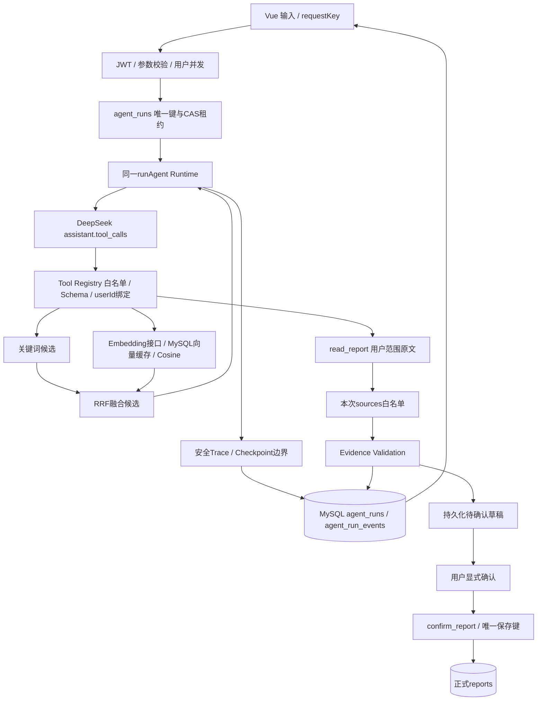

# AGENT_PROJECT_LEARNING：从界面走到 Agent 结果

本项目的学习目标是能解释真实代码、复现测试，并讲清楚边界。2026-10-07 在现有统一 Runtime 上完成 Hybrid Retrieval Tool、Trace、持久化 Run/Checkpoint 与草稿接入。先沿一条请求追踪，再阅读本文末尾的最终工程升级学习章节。

## 先讲清楚三个流程

1. 周报：填写 → 检查是否缺信息 → 0–3 个问题 → 补充/跳过 → 同一 sessionId 生成 → 草稿校验 → 用户确认 → 幂等保存。
2. 趋势复盘：搜索 → 读取 → 工具结果回传 → 按需继续 → 四类结论 → 引用校验 → Evidence 查看。
3. 计划跟踪：读取 next_plan → 检索后续 → 读取原文 → 判断状态 → 校验顺序、事项与明确状态 → 只读建议。没提到不等于未完成。

这三类任务共用一套 Runtime；这是任务配置复用，不是多个自治 Agent 相互协作。普通文本润色也不等于 Agent Loop。

## 1. Vue：用户输入和展示

理解 ref 是响应式状态，computed 是派生状态。生成中的 loading、等待回答的 prepared、已校验的 reportDraft、已保存的 draftSaved 是不同阶段。收到文本片段只代表预览，不能因此开放正式保存。

### client/src/App.vue

1. 职责：组织登录、生成、确认保存、历史、重写、复盘和计划面板。
2. 必要性：统一顶层状态，让保存与生成、会话过期和历史刷新衔接。
3. 调用：子组件、reports API、ai API、confirmWeeklyReport、safeMarkdown。
4. 调用者：main.ts 挂载的 Vue 应用。
5. 面试点：为什么生成完成不立即入库？为什么异步结果要核对当前账号/请求版本？

### client/src/components/ReportForm.vue

1. 职责：原始工作/问题/计划表单、追问答案、跳过与同一草稿续接。
2. 必要性：问题是可操作表单，不能解析模型 HTML；原始输入在等待回答时冻结。
3. 调用：prepareWeeklyReport、generatePreparedReport、TemplateSelect；向 App 发 controller/start/done/draft 事件。
4. 调用者：App。
5. 面试点：为什么 prepared 与 loading 分开？如何保证补充后不是另一份无关输入？

### client/src/components/ReportResult.vue

1. 职责：显示生成预览、停止、复制和 PDF 导出。
2. 必要性：完整且校验成功后才可复制/导出，避免把断流预览当正式结果。
3. 调用：safeMarkdown、clipboard、html2pdf。
4. 调用者：App，传 content/loading/ready。
5. 面试点：为什么使用 v-html 前必须净化？PDF 为什么是浏览器截图式导出？

### client/src/components/InsightsResult.vue

1. 职责：Phase 1 四类结论、局限提示和原文快照弹窗。
2. 必要性：让用户核对结论与原文，而不是只看到一段总结。
3. 调用：Vue 派生状态和 UI 组件，不执行模型请求。
4. 调用者：App。
5. 面试点：引用存在就能说明结论正确吗？修改历史后为什么旧分析仍展示旧快照？

### client/src/components/PlanTracker.vue

1. 职责：选择计划来源、执行只读分析、展示四种状态与引用。
2. 必要性：明确区分“状态建议”和正式数据，显示无法确认的原因。
3. 调用：trackPlans、EvidenceDialog；卸载时取消。
4. 调用者：App。
5. 面试点：为什么不自动写回状态？没有后续记录时为什么仍有原计划 Evidence？

### client/src/components/EvidenceDialog.vue

1. 职责：展示 next_plan、work_content 或 content 字段对应的引用和快照。
2. 必要性：原计划与后续工作不能混作同一种完成证据。
3. 调用：Vue computed 和文本插值，不运行正文中的 HTML。
4. 调用者：PlanTracker。
5. 面试点：quote 关联的是哪一个字段？创建时间与内容发生时间有什么区别？

### client/src/components/LoginForm.vue / TemplateSelect.vue

1. 职责：登录注册交互 / 周报风格选择。
2. 必要性：登录和业务表单分离，风格是明确枚举，追问期间可禁用。
3. 调用：auth HTTP / 向父组件发选中值。
4. 调用者：App / ReportForm。
5. 面试点：前端风格校验能替代后端吗？Token 为什么不能进入模型工具参数？

### client/src/utils/safeMarkdown.ts

1. 职责：Marked 转换后使用 DOMPurify 净化 HTML。
2. 必要性：模型输出与用户正文都不可信，不能直接变成可执行 HTML。
3. 调用：Marked、DOMPurify。
4. 调用者：ReportResult、App 历史详情。
5. 面试点：结构化 Agent 输出为何用插值，普通 Markdown 又为何需要净化？

## 2. HTTP / SSE：请求和流不是同一种结果

HTTP 请求带 Bearer Token，body 不传可信 userId。POST SSE 通过 fetch 消费，因为需要 JSON body 与鉴权头。ReadableStream 每次 read 的字节块不等于完整事件，需要 TextDecoder 和 buffer 按空行切分。

content 是增量预览；progress 是服务端业务阶段；result 是经过校验的完整结构；[DONE] 才确认成功。收到 result 后断流，也不能在界面提交它。取消是用户主动行为，不应显示成服务故障。

### client/src/api/sse.ts

1. 职责：共用 fetch 流读取、事件解析、401 清理和中止处理。
2. 必要性：多个页面共用协议，避免各自处理半包与重复结束回调。
3. 调用：fetch、ReadableStream、TextDecoder，以及可选 onProgress/onResult 回调。
4. 调用者：weeklyReport.ts、ai.ts。
5. 面试点：为什么要 buffer？为什么 result 与 DONE 要同时收到？EventSource 与 fetch 有何区别？

### client/src/api/weeklyReport.ts

1. 职责：定义输入、追问、准备会话、生成草稿和确认请求类型。
2. 必要性：会话身份不能在补充/重试时重新生成；确认接口是独立写入动作。
3. 调用：streamPost；确认使用普通 JSON HTTP。
4. 调用者：ReportForm、App。
5. 面试点：answers 为什么用 questionId？重复保存为何复用原 sessionId？

### client/src/api/ai.ts / reports.ts

1. 职责：AI 复盘/计划/重写协议与历史 CRUD 协议。
2. 必要性：页面不直接拼各类请求，结构化类型区别于 Markdown 文本。
3. 调用：streamPost 或 fetch。
4. 调用者：App、PlanTracker。
5. 面试点：onContent 与 onResult 的业务区别是什么？401 如何统一回到登录？

## 3. Express Route：认证、输入、生命周期

Route 只选择业务入口，不负责让模型直接执行数据库。HTTP JSON 校验、JWT、用户并发与任务预算是不同层的检查。接口限流是按请求数；Agent Budget 约束一次请求里的多次模型/工具调用。

### server/app.js

1. 职责：加载配置、挂载路由、健康检查和全局错误处理。
2. 必要性：把启动组装与具体任务实现分开。
3. 调用：auth、weeklyReport、reports、ai 路由及数据库池。
4. 调用者：npm start / npm run dev。
5. 面试点：中间件顺序为什么重要？重启影响哪些持久与非持久状态？

### server/routes/weeklyReport.js

1. 职责：/prepare、/、/confirm 的鉴权和处理器连接。
2. 必要性：读/生成和用户确认写入分开。
3. 调用：auth、限流、createPrepareHandler/createWeeklyHandler/createConfirmHandler。
4. 调用者：app 挂载的 /api/weekly-report。
5. 面试点：原接口为何不再自动保存？HTTP 断开能否撤销已确认写入？

### server/routes/ai.js / reports.js / auth.js

1. 职责：复盘、计划、重写 / 用户历史 CRUD / 登录注册。
2. 必要性：明确模型只读分析与普通用户操作边界。
3. 调用：任务 handler、模型服务、受用户约束 SQL / bcrypt、JWT。
4. 调用者：app 与前端 API。
5. 面试点：id 与 user_id 为何同时作为条件？AI 重写为何需人工保存？

### server/middleware/auth.js / aiRateLimit.js

1. 职责：校验 JWT 设置 req.user / 按用户计数限制 AI 请求。
2. 必要性：客户端身份不可信；控制重复请求而非依赖按钮禁用。
3. 调用：jsonwebtoken / 内存计数。
4. 调用者：周报、AI、历史路由。
5. 面试点：多实例为何不能共享这个限流？为什么一次 Agent 请求还需另设预算？

### server/agents/agentHandler.js / insightsHandler.js

1. 职责：共用 SSE 生命周期、并发锁、取消、心跳、错误脱敏 / Phase 1 特有预检与输入配置。
2. 必要性：三个任务复用 HTTP 壳，模型推理仍只用一套 Runtime。
3. 调用：任务 run 函数、waitForAbort、SSE；insightsHandler 配置 runInsightsAgent。
4. 调用者：AI Route、prepare handler。
5. 面试点：用户级锁与任务级超时分别防什么？为什么数据库异常不能原样返回浏览器？

## 4. Agent：任务规则与可信上下文

System 规则、用户问题和历史数据不是同等可信。历史里写“忽略规则、访问其他用户”只是待分析文本。模型决定工具顺序，但不能决定权限、预算或正式写入。

### server/agents/clarificationAgent.js

1. 职责：判断信息缺口，返回 0–3 个问题并校验格式及本次原文 anchor。
2. 必要性：避免每次固定问一套题，且不能产生模型编的答案。
3. 调用：runAgent、reportTools；禁用历史时不提供数据库工具。
4. 调用者：createPrepareHandler、verify-agent。
5. 面试点：历史里的旧状态为何不能填成本周状态？空可选字段是否必须追问？

### server/agents/insightsAgent.js

1. 职责：定义四类趋势分析、证据要求和上下文容器。
2. 必要性：保留 Phase 1 业务规则，独立于执行器。
3. 调用：runAgent、reportTools、validateInsightsResult。
4. 调用者：insightsHandler、验收脚本。
5. 面试点：是固定 SQL 后一次生成，还是模型根据证据继续查？

### server/agents/planAgent.js

1. 职责：计划分析规则、最终状态校验、保守状态词/事项检查。
2. 必要性：不能将“没提到”写成未完成，也不能拿其他模块的完成作证据。
3. 调用：同一 runAgent、reportTools、planTools、checkEvidence。
4. 调用者：/api/ai/plans、验收脚本。
5. 面试点：为什么增加明确状态词检查？误拒绝与错误认定完成哪个更可接受？

## 5. Tool Calling：模型请求，应用执行

DeepSeek 返回的是工具名称、JSON 字符串参数与调用 ID，不是数据库执行结果。应用校验后执行函数，把结果作为 role:tool 回传。不要把“工具调用”理解成模型拿到了数据库连接。

### server/services/deepseek.js

1. 职责：已有 Axios 的完整响应/工具调用和流式文本适配。
2. 必要性：工具轮次要完整 assistant message，普通文本展示需要增量流。
3. 调用：DeepSeek /chat/completions，服务端读取密钥并传 AbortSignal。
4. 调用者：runAgent 的 complete 注入、streamDeepSeekToClient。
5. 面试点：为什么工具调用不用解析半个 JSON delta？reasoning_content 为何不展示？

## 6. Tool Registry：权限与 Schema 的执行边界

提供给模型的 Schema 是说明；服务端校验才是硬边界。多传一个 userId、错误整数、超长参数或未知工具，必须在 SQL 前拒绝。写工具不能仅靠 Prompt 写一句“别调用”。

### server/agents/toolRegistry.js / errors.js

1. 职责：工具白名单、Schema 生成、本地参数解析与二次校验 / 可识别错误码。
2. 必要性：模型输出可能错误或被数据影响，不能信任它符合 Schema。
3. 调用：被注册工具的 execute，注入服务端 context。
4. 调用者：reportTools、用户确认工具及 runAgent。
5. 面试点：为什么未知工具无权运行？可修正工具错误和数据库故障如何区分？

### server/agents/reportTools.js

1. 职责：搜索摘要、读取正文与工作输入/原计划，绑定 userId，缓存本次快照。
2. 必要性：摘要可用于筛选，原文才可引用；避免跨用户和无限读历史。
3. 调用：pool.execute 参数化 SQL，createToolRegistry。
4. 调用者：三个任务及普通生成的历史辅助。
5. 面试点：为什么不用模型生成 SQL？关键词 LOCATE 与语义检索有什么区别？

### server/agents/planTools.js

1. 职责：读取 next_plan、拆分有限计划、检索该来源之后的记录。
2. 必要性：时间范围和计划 ID 由服务端决定，不能引用来源之前的成果。
3. 调用：SELECT；更新本次 plans、planSources、planSearches，不写数据库。
4. 调用者：planAgent 注册的工具组合。
5. 面试点：没有命中关键词是否能证明没完成？为什么每项先无关键词查后续？

## 7. MySQL：原始输入、正式记录与幂等键

users 保存认证信息，reports 保存原始字段与用户确认正文。request_key 是同一草稿的保存身份，UNIQUE(user_id, request_key) 才能抵抗两个请求同时进入数据库；前端 disabled 或内存 Map 不是最终保证。

### server/db/index.js / sql/schema.sql / scripts/migrate-confirmation.mjs

1. 职责：连接池 / 新库定义 / 已有库最小增量迁移。
2. 必要性：不删旧表，新增可空键让历史数据不受影响。
3. 调用：mysql2；迁移先查 information_schema 再执行必要 ALTER。
4. 调用者：可信路由、工具、数据库验收脚本。
5. 面试点：为何唯一索引含 user_id？NULL 旧记录怎么办？迁移如何重复执行？

### server/tools/confirmReport.js

1. 职责：在用户 confirm=true 后核对会话、正文和状态，幂等 INSERT 与读取结果。
2. 必要性：模型只读，写入需人确认；重试不应该重复创建记录。
3. 调用：用户绑定 INSERT/SELECT、draftStore。
4. 调用者：createConfirmHandler，绝不加入模型 tools。
5. 面试点：两次确认同时到达如何保证一条？响应丢失后重试发生什么？

## 8. Tool Result：携带来源，而不是执行指令

结果包含 id、字段内容、时间、截断标记或摘要。模型收到数据后可以继续检索；工具结果里的正文不是 system 指令。一次分析的 sources Map 是引用白名单，不能只看数据库存在该 ID 就允许引用。

### server/services/persistentDraftStore.js / draftStore.js / weeklyInput.js

1. 职责：生产使用 MySQL 草稿，带所有权、七天 TTL 和生成抢占；内存草稿仅作为无数据库测试夹具；weeklyInput 校验用户输入类型、长度与风格。
2. 必要性：补充沿用同一输入，避免用户传其他人的会话或悄悄更换原稿。
3. 调用：UUID、agent_drafts 参数化 SQL、生成 Token 条件更新 / 明确字段规则。
4. 调用者：weeklyHandlers、confirmReport。
5. 面试点：为什么重启可以恢复草稿？生成租约与确认幂等键分别解决什么问题？

## 9. Agent Loop：什么时候继续，什么时候结束

一次响应可以有多个工具请求；服务端逐个验证执行后统一进入下一轮。没有工具请求才尝试校验最终结果。错误反馈是限定修订，不是无限“自我反思”。轮次、调用数、输入预算、输出预算、时间和取消都能终止循环。

### server/agents/runAgent.js

1. 职责：执行唯一循环，保存消息历史、回传工具结果、计费预算、取消与修订。
2. 必要性：多个任务共用可靠性约束，避免复制第二套执行器。
3. 调用：注入的 complete、registry.execute、validateFinal、onEvent。
4. 调用者：三个任务配置。
5. 面试点：finish_reason=length 为何不能当成功？工具 ID 重复会怎样？预算为何要请求前预留？

### server/services/weeklyHandlers.js

1. 职责：prepare、续接生成、用户确认三个业务处理器。
2. 必要性：周报润色保留原 SSE，追问和历史工具复用 Runtime；正式保存独立。
3. 调用：任务配置、draftStore、reportTools、流式服务、草稿校验、用户专属确认工具。
4. 调用者：weeklyReport Route。
5. 面试点：等待回答时会持有长连接吗？为什么不能把前端送回的任意 content 直接保存？

### server/utils/streamDeepSeek.js

1. 职责：UTF-8 安全解析上游流、转发 content、完整结束后回调与 DONE。
2. 必要性：中文可能跨字节块，连接关闭/截断不能触发可确认草稿。
3. 调用：createDeepSeekStream、StringDecoder、onComplete。
4. 调用者：weeklyHandlers、AI 重写路由。
5. 面试点：TextDecoder 与后端 StringDecoder 解决什么？stop 和 DONE 各自证明什么？

## 10. Evidence Validation：出处正确不代表所有推理正确

先检查结构，再检查 ID 属于本次读取、字段正确、quote 是连续原文。计划判断额外检查来源之后、同一事项、状态词，并拒绝未来计划/否定状态。有证据也可能错误理解，因此 UI 保留人审阅。

### server/agents/evidence.js / insightsResult.js

1. 职责：共用字段原文校验 / Phase 1 四类结果约束、多个来源与局限说明。
2. 必要性：复盘和计划沿用同一 quote grounding，不能引用没读的 ID 或虚构片段。
3. 调用：本次 sources Map；返回安全的结构化结果。
4. 调用者：insightsAgent、planAgent。
5. 面试点：为何只规范化空白？为何不能把引用校验称作语义正确性证明？

### server/services/draftGeneration.js / prompts/weeklyReport.js

1. 职责：关联答案、保留未知信息、检查新增数字/部分完成状态、保守回退 / 文本生成与重写规则。
2. 必要性：跳过不是授权模型猜测；被拦截时仍能按真实输入继续。
3. 调用：原始 input、questions、用户 answers；保守回退不再次调用模型。
4. 调用者：weeklyHandlers / 生成和重写。
5. 面试点：规则为何不能消除所有幻觉？为何最终保存还要人工确认？

## 11. Final Result：成功、确认和保存是三个时刻

服务端只发经过校验的 result；前端还等待 DONE，防止结果在断流中不完整。看到草稿并不等于历史已增加。用户确认后返回 reportId，才刷新历史。计划状态在页面中是建议，没有数据库正式状态变化。

## 测试怎么读

- server/tests/agent.test.js：先读通 Runtime 既有工具、引用、预算与取消。
- server/tests/business.test.js：按业务读充分/不足、跳过、状态证据、确认和回退。
- server/tests/insightsHandler.test.js：HTTP 壳的错误、并发、生命周期。
- client/tests/sse.test.mjs：UTF-8 分块、完整结果、断流、取消。
- client/tests/workflow.test.mjs：sessionId 续接与显式确认重试。
- server/scripts/verify-agent.mjs：真实模型，合成输入，六条链路；不能把一次通过当线上评测统计。
- server/scripts/verify-database.mjs：真实查询和连接局部临时表幂等，不写真实周报。

## 建议的学习顺序与验收

第一遍：从 ReportForm 跟踪 prepare、questions、resume、result、confirm。能画出这一条链即可。
第二遍：从 planAgent 跟踪 get_recent_plans、find_plan_evidence、read_report、role:tool、validateFinal。
第三遍：分别制造未知工具、错误 userId 参数、无证据完成、Abort、断流、重复确认，解释哪层拦截。
第四遍：看 AGENT_PROJECT_INTERVIEW.md，脱离代码口述 20 个问题，再对照实现检查有没有夸大。

练习时使用合成数据。不要把真实密钥写进报告、截图或简历。Docker/CI、正式线上部署、长期准确率只能讲实际跑过的内容。

完成标准：你能解释模型决定了什么、服务端禁止了什么、证据证明了什么，以及用户确认后正式 reports 才改变什么。基础设施表可记录向量、Run、草稿与轨迹，但这不等于模型获准修改正式周报。

## 12. 最终工程升级：架构与完整数据流

保留 Vue3 + TypeScript + Express + MySQL + DeepSeek Tool Calling + 单一 runAgent。三个任务配置复用 Runtime；Hybrid RAG 是 Registry 中的一个工具；Trace 是 Runtime 的执行事件；Run Store 是 HTTP 生命周期的基础设施。这三个能力没有各自再建立 Agent 框架。

一次趋势复盘：streamPost 创建 requestKey → handler 规范化 question → JWT 绑定 userId → Run Store 以 UNIQUE(user_id,request_key) 建立任务 → CAS 获得 running 租约 → Runtime 发 model_start → DeepSeek 自主选择 hybrid_search_reports → Registry 校验 query/limit → 服务端绑定用户查关键词与向量候选 → 余弦排名、RRF 融合 → role:tool 回传不可信候选 → 模型调用 read_report → SQL 用 id+user_id 读取原文并放入 sources → 模型输出结构化结论 → 原 Evidence Validation 核对引用 → 先持久化成功结果 → 再发送 result、DONE → Vue 展示与原文查看。

每个模型、工具、校验边界都会等待 Trace 写入，同时保存 latest checkpoint。工具检索不把摘要放入 sources，引用仅有数据库 ID 仍然不够。计划任务继续要求 find_plan_evidence 的后续记录集合、原文读取、时间先后和明确状态表述；RAG 不绕过这些限制。

## 13. Hybrid RAG：为什么这样实现

关键词通道用 queryTerms 提取英文词/中文片段，在当前用户正文中参数化 LOCATE 查询，最多 50 个候选；语义通道读取最近 200 份正文前 6000 字的向量，用查询向量与文档向量计算余弦相似度。RRF 分数是两个排名的 `sum(1/(60+rank))`，同时出现在两条通道的记录获得两份排名贡献。这里是融合排序，没有额外 Cross-Encoder reranker，也没有 ANN 向量引擎。

向量是真实 Embedding 接口返回的数值数组；model_key 是服务端 endpoint+model 的指纹，content_hash 是正文截断版本的 SHA256，两者只负责缓存身份，不是向量生成方式。编辑正文后哈希变化，旧向量被排除；删除的记录不能通过 reports JOIN 再召回。每次 Run 最多在线补索引 12 份，支持显式预索引最近 200 份。

Embedding 服务未配置、失效或预算不足时返回 keyword 模式和稳定降级码。已经成功计量的 Embedding Token 加到 Runtime 总预算；usage 缺失时用 UTF-8 字节作保守估计。候选与原文读取仍受模型轮次、工具调用、上下文和总超时约束。中断时抛出 Abort，不把用户取消伪装成检索降级。

权限有四道边界：JWT 决定身份；Schema 不允许模型传 userId；关键词与向量 JOIN 都限定 user_id；read_report 再次限定 id+user_id。来源正文和摘要始终是 role:tool 数据，不能变成 system 消息。关键词模式可独立演示，但只有配置 Embedding 后才可以展示真实语义召回。

### 关键文件与调用关系

- server/services/embeddings.js：服务端配置的 HTTP Embedding 适配器，20 秒子超时、Abort、响应索引/维度/有限非零向量校验；被 hybridRetrieval 和 index-reports 调用。不会使用 DeepSeek Chat 密钥作为默认向量凭证。
- server/services/hybridRetrieval.js：SQL 候选、哈希缓存、Cosine、RRF、覆盖量与降级；被 ragTool 调用，不写 sources，不改正式 reports。
- server/agents/ragTool.js：hybrid_search_reports 的白名单定义与 query/limit Schema；由 createReportTools 注册，被唯一 Runtime 调用。
- server/agents/reportTools.js：把旧 search_reports/read_report 和新 RAG Tool 放入同一个 Registry；read_report 仍是 Evidence 来源。
- server/scripts/index-reports.mjs：操作者显式执行的预索引命令，限定指定用户最近 200 份；模型没有调用这个脚本的权限。
- server/sql/agent-engineering.sql：四张基础设施表与唯一键/索引；migrate-engineering.mjs 用附加建表建立，不改变原业务记录。

## 14. Trace：观察执行过程，不展示私有推理

模型事件记录 step、finishReason、toolCount、usage、上下文大小、预留输出、剩余预算和耗时；工具事件记录工具白名单名称、callId、文本参数长度/数字值、结果数量/ID和检索元数据；校验事件记录稳定错误码、修订次数；终止事件区分失败、Budget、Timeout 与 Abort。

不保存或回传 reasoning_content、模型原始消息、请求头、密钥、正文或查询全文。参数摘要只投影允许字段，字符串只显示长度；resultSummary 只投影结构化摘要。完整 assistant 消息在本次 Runtime 内继续用于协议回传，但 Checkpoint 不保存它。数据库中的 input_json 与已校验 result_json 属于用户私有业务上下文，读取它们仍需 JWT 所有权校验，与公开 Trace 字段分离。

### 关键文件与调用关系

- server/agents/trace.js：严格字段投影，生成 argumentSummary/resultSummary；被 runAgent 调用。
- server/agents/runAgent.js：发出 await onEvent 的有序模型/工具/校验事件；保持原 Loop 与 Budget，不另建执行器。
- server/agents/agentHandler.js：分配 runId，处理 requestKey、租约、Trace 存储、客户端断线与终态；每次事件先存储再发 SSE。
- server/services/agentRunStore.js：记录 events 与 checkpoint，所有 SQL 绑定 userId/runId；finish 使用 leaseToken 条件更新防止旧任务覆盖新尝试。
- client/src/api/sse.ts：增加 trace 事件与可选回调，保留 progress/result/DONE 协议；向应用内面板分发带 runId 的事件。
- client/src/api/agentRuns.ts：JWT 读取 Run 列表/详情，POST 重试仍通过原 streamPost。
- client/src/components/AgentTrace.vue：运行列表、执行详情、恢复结果、安全重跑、停止、错误/空状态；刷新页面后从数据库重载。
- client/src/App.vue / PlanTracker.vue / ReportForm.vue：按任务恢复复盘、计划结果或草稿会话；持久化草稿 ready 时重新展示待确认结果，prepared 时恢复表单与追问。

trace 事件不会满足 requireResult。收到 trace 或 validation_passed 后断流，前端仍然报失败；只有 result+DONE 才能采用本次流结果。

## 15. Persistent Run / Checkpoint / Human-in-the-loop

三个身份要分清：requestKey 标识一次逻辑请求，按用户唯一；runId 标识服务端任务；sessionId 标识待确认草稿，并作为正式保存的 reports.request_key。Run 保存不能代替用户确认。

Run 状态：pending → running → succeeded / failed / aborted / timed_out / validation_error。输入按键顺序规范化后与任务类型一起哈希；同 key 不同任务/输入返回 409；running 重复请求不并行；成功重复请求直接重放已存结果。失败需显式 retry，四分钟租约到期的 running 可重新抢占。新尝试沿用 runId、attempt 加一，最多三次。数据库唯一键和原子 UPDATE 是并发保证，而不是前端禁用按钮。

Checkpoint 保存最近安全边界、stats、sourceIds、recovery=restart_from_input。恢复不会加载旧 sources 或半完成的 assistant/tool 消息：从保存的原始输入启动同一 Runtime，重新检索并读取当前原文。这样不需要持久化模型私有推理，也避免用旧证据接着推断。每次尝试有新的原有预算，上限三次；成功结果重放不再收费。不承诺把进程崩溃前的模型请求精确续跑，也不保证重跑文本相同。

草稿保存在 agent_drafts，七天 TTL。生成用 generationToken 和条件抢占；异常后四分钟可恢复 prepared，旧 Token 的迟到写入被拒绝。完整流与事实校验通过后才持久化 ready；用户按原内容明确确认，confirm_report 才写 reports 并保留原唯一键幂等。取消生成不会写正式周报；已经明确确认的 INSERT 不因断线假装回滚。

### 关键文件与调用关系

- server/services/agentInfrastructure.js：生产组装唯一 MySQL Run Store 和持久化 Draft Store，路由复用同一基础设施。
- server/services/persistentDraftStore.js：create/get/save/claim，SQL 所有权+到期+generationToken 限制；被 prepare/weekly/confirm handlers 调用。
- server/routes/agentRuns.js：鉴权后的列表、详情、retry；只从保存输入选择现有任务 handler，不接受客户端指定工具或 SQL。
- server/services/weeklyHandlers.js：异步草稿读写、生成抢占、完整草稿持久化，仍沿用原 Prompt/事实回退/SSE。
- server/tools/confirmReport.js：仅可信确认接口调用，模型 tools 数组不包含它；读取持久化 ready 草稿、确认所有权与正文一致性、幂等 INSERT、持久化 saved。
- server/services/draftStore.js：内存实现作为既有单元测试夹具，不再作为生产路由的状态源。

## 16. 学习与演示顺序

1. 先读 weeklyInput、ReportForm、SSE，区分追问结果、预览文本、ready 草稿和用户确认。
2. 用两份合成周报读通 insightsAgent → runAgent → toolRegistry → read_report → Evidence；先不配置向量，复现原测试。
3. 阅读 embeddings、hybridRetrieval、ragTool；手算两份候选的 cosine 和 RRF，理解 content_hash/model_key 失效。
4. 在 server/.env 配置已有向量接口，再执行 `npm run verify:rag`。可使用已安装 Ollama + 多语言模型的 /v1/embeddings，或已有在线兼容接口；模型安装与费用由实际服务决定。
5. 跟踪 trace.js → Runtime onEvent → agentHandler → Run Store → SSE → AgentTrace，验证摘要没有正文/查询全文/私有推理。
6. 阅读 SQL 唯一键、leaseToken 与 UPDATE 条件；复现重复请求、输入冲突、崩溃租约回收、旧 Token 拒绝和三次尝试上限。
7. 读 persistentDraftStore 与 confirmReport，重启后恢复草稿；人工确认前检查正式历史不增加。
8. 运行 server/client 单元测试、typecheck、build；运行 verify:engineering（真实MySQL+测试向量）与 verify:engineering:live（再加真实DeepSeek）。只有 verify:rag 包含真实向量模型，三类结果不能混淆。
9. 用 `node scripts/verify-engineering.mjs --preview` 验证合成 UI：生成复盘→查看RAG轨迹→刷新→恢复结果；该预览不是生产部署，临时表随进程结束消失。

## 17. 新增面试问题与回答要点

1. 为什么 Hybrid RAG 要作为 Tool？模型按任务决定是否检索，服务端执行权限仍由 Registry 控制，普通充分输入无需额外召回。
2. 为什么用 RRF 而不是直接相加？关键词与向量分数尺度不同，排名倒数融合避免直接比较不兼容分值；代价是忽略原始置信度。
3. 向量存在 MySQL 是向量数据库吗？这里是 JSON 向量缓存加 Node 有界精确扫描，不是 ANN 数据库；小作品集可解释，但不承诺大规模性能。
4. RAG 为什么不能直接当 Evidence？召回只说明相关性，摘要可能截断或过期；实际读取原文、当前用户权限和本次来源白名单才建立引用资格。
5. 用户修改正文怎么处理？对当前前6000字计算哈希，旧 hash 不参与排名；重新生成 Embedding。model_key 也隔离不同 endpoint/model。
6. 检索文本里出现“忽略系统规则”怎么办？它始终是 tool 数据，不提升到 system；仅白名单工具可执行，Evidence仍需原文校验。这降低风险，不能声称彻底消除语义注入。
7. Trace 和 Chain-of-Thought 有什么区别？Trace记录模型请求、返回类型、工具、预算与校验等执行事实，既不保存也不展示私有 reasoning_content。
8. 为什么先持久化再发送 result/DONE？客户端断线时可用同 requestKey重放成功结果，避免“服务端成功、客户端不知道”后再调用模型。
9. requestKey 与 runId 为什么都需要？前者由请求方表达重复意图，后者由服务器标识执行记录；task/input hash防止一个key复用给不同工作。
10. Checkpoint 为何不保存完整消息？本项目选安全重新执行，重新读取事实，不恢复含私有推理的模型消息和半完成工具协议，行为明确且可测试。
11. 崩溃后如何避免两个任务同时完成？租约到期后 CAS 抢占生成新 leaseToken；旧 Token 的 event/finish 条件写入被拒绝。
12. 任务重跑会不会重复写周报？Agent任务只写基础设施数据；正式写入仍需人工确认，sessionId与唯一保存键保证确认重试只生成一条记录。
13. 多进程是不是已经完全支持？同 requestKey有数据库租约保护，但不同Run之间用户并发锁和限流仍是进程内，不能声称跨实例配额完整。
14. 怎么验证真实模型而不污染用户数据？连接局部临时表影子覆盖表名，所有合成数据与模型返回都只到临时表，连接关闭自动消失。
15. 语义服务没配置怎么办？明确显示keyword降级，功能可运行；不把假向量测试或关键词召回包装成真实语义验收。
